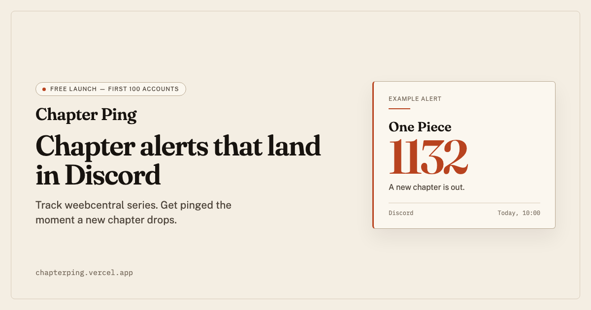

# Chapter Ping



Free Discord alerts when a new manga chapter drops. Pick the series you read on
[weebcentral](https://weebcentral.com), paste a Discord webhook, and get one clean
message when a chapter is out.

**Live site:** <https://chapterping.vercel.app>

## How to use it

1. **Sign in with Discord.** One click, no password. It asks for your name and avatar only.
2. **Add a channel.** In Discord: Channel settings → Integrations → Webhooks → New Webhook → Copy Webhook URL. Paste that URL into Chapter Ping. No bot to invite, no permissions to grant.
3. **Pick a series.** Search weebcentral inside the app, choose the cover, and send it to a channel.
4. **Get the ping.** A cron checks each series about every 30 minutes and posts the chapter number, title and link. Add a role ID if you want the alert to mention a role.

You can track up to 5 series and send to 2 Discord channels. Pause a series any time; paused series do not use a check slot.

## Why 100 accounts, and why the limits

Chapter Ping runs entirely on Cloudflare's free tier, and nobody pays for it. The caps are what keep it inside that free tier:

| Limit | Value |
|---|---|
| Accounts | 100 (an account counts once it tracks a series) |
| Series per account | 5 active |
| Discord destinations per account | 2 |
| Distinct series across the service | 150 |
| Check interval | About every 30 minutes |

Cloudflare's free plan allows 100,000 Worker requests a day, and D1 has daily read and write limits. 150 series checked every 30 minutes is 300 feed checks an hour, plus the app and Discord calls. That is the comfortable ceiling. Raising it would mean a bill.

**There will never be a paid tier.** No card, no ads, no sponsorships, nothing for sale. It is first come, first served: the first 100 accounts that add a series get in. When the spots are full, new sign-ins join a waitlist and are let in as places free up. Existing accounts keep working.

## Run it yourself

You need Node 22+, a Cloudflare account, and a Discord application.

```bash
npm install
cp .dev.vars.example .dev.vars
```

Fill in `.dev.vars`:

| Variable | Where it comes from |
|---|---|
| `DISCORD_CLIENT_ID` / `DISCORD_CLIENT_SECRET` | Discord Developer Portal → your app → OAuth2 |
| `BETTER_AUTH_SECRET` | `openssl rand -hex 32` |
| `WEBHOOK_ENCRYPTION_KEY` | `openssl rand -base64 32` |

In the Discord portal, add the redirect `http://localhost:8787/api/auth/callback/discord`. Then:

```bash
npm run db:migrate:local
npm run dev
```

Open <http://localhost:8787>. Health check: `curl http://localhost:8787/api/health`.

### Deploy

```bash
npx wrangler d1 create chapter-tracker-web   # copy database_id into wrangler.jsonc
npm run db:migrate:remote
npm run deploy
```

Set the production secrets:

```bash
npx wrangler secret put DISCORD_CLIENT_ID
npx wrangler secret put DISCORD_CLIENT_SECRET
npx wrangler secret put BETTER_AUTH_SECRET
npx wrangler secret put WEBHOOK_ENCRYPTION_KEY
```

`APP_URL`, `PUBLIC_URL` and the capacity caps live in `wrangler.jsonc`. Optional secrets: `ADMIN_DISCORD_IDS` for the owner desk and `ALERT_WEBHOOK_URL` for cron failure alerts.

## Stack

React 19 + Vite single-page app, Hono on Cloudflare Workers, D1 for storage, and one cron trigger every five minutes.

- Discord OAuth with the `identify` scope only.
- Webhook URLs encrypted at rest with AES-256-GCM and never returned after saving.
- Every query scoped to the signed-in user; same-origin checks on mutations.
- CSP, HSTS in production, and rate limits on public endpoints.

## Checks

```bash
npm run typecheck
npm run lint
npm test
npm run build
```

All outbound HTTP is mocked in tests; nothing contacts Discord or weebcentral.

## Privacy, terms, license

Read [PRIVACY.md](PRIVACY.md) and [TERMS.md](TERMS.md). Deleting your account in Settings removes your sessions, series, destinations and delivery history.

MIT. See [LICENSE](LICENSE). Not affiliated with weebcentral or Discord; no chapter content is hosted.
